<div align="center">

<h3><code>itsmayankmis@github ~ $ ./contributions.sh</code></h3>

<br><br>

<h3><code>itsmayankmis@github ~ $ whoami</code></h3>
<table>
  <tr>
    <td valign="top"></td>
    <td valign="top"></td>
  </tr>
</table>
<br>

<h3><code>itsmayankmis@github ~ $ ./links.sh</code></h3>
<b>Mayank Mishra</b><br>
Mechanical Engineering Student · CAD/CAE · 3D Modelling · Mechanical Design<br>
📍 <i>Bareilly, Uttar Pradesh, India</i><br><br>

<a href="https://github.com/itsmayankmis" target="_blank">
  
</a>
<a href="https://linkedin.com/in/itsmayankmis" target="_blank">
  
</a>
<a href="mailto:mishra.mayankkk@gmail.com">
  
</a>
<a href="https://www.instagram.com/sapien_called_mayank" target="_blank">
  
</a>

</div>

<br>
<hr>
<br>

### <code>itsmayankmis@github ~ $ cat profile-summary.txt</code>

> Final-year Mechanical Engineering undergraduate at **Bundelkhand Institute of Engineering and Technology (BIET), Jhansi** (2023–2027), with extensive hands-on experience in CAD, 3D modelling, mechanical assemblies, and engineering simulation.
>
> Primarily specializing in **SolidWorks**, with practical exposure to mechanical systems through engine modelling, go-kart maintenance, and engineering projects. Currently expanding technical capabilities across **CAE**, **Python**, **robotics**, and **engineering automation**.

<br>

### <code>itsmayankmis@github ~ $ ./skills.sh --all</code>

<table>
  <tr>
    <th align="left" width="28%">Domain</th>
    <th align="left" width="72%">Technologies, Tools & Engineering Capabilities</th>
  </tr>
  <tr>
    <td><b>CAD & 3D Modelling</b></td>
    <td>
      
      
      
      <br>
      <code>3D Modelling</code> · <code>Assembly Design & Mates</code> · <code>Sheet Metal</code> · <code>Engineering Drawings</code>
    </td>
  </tr>
  <tr>
    <td><b>CAE & Simulation</b></td>
    <td>
      
      
      <br>
      <code>Motion Studies</code> · <code>Thermal Analysis</code> · <code>Flow Simulation</code> · <code>Pressure/Load & Deformation Analysis</code>
    </td>
  </tr>
  <tr>
    <td><b>Mechanical Systems</b></td>
    <td>
      <code>Mechanical Design</code> · <code>Machine Components</code> · <code>Vehicle Systems</code> · <code>Fabrication & Welding</code> · <code>Ackermann Steering</code>
    </td>
  </tr>
  <tr>
    <td><b>Programming & Embedded</b></td>
    <td>
      
      
      
      
      <br>
      <code>Onboard Computers</code> · <code>Drone Flight Controllers</code> · <code>Hardware Interfacing</code>
    </td>
  </tr>
  <tr>
    <td><b>Languages</b></td>
    <td>
      <b>Hindi</b> (Native / Fluent) · <b>English</b> (Conversational)
    </td>
  </tr>
</table>

<br>

### <code>itsmayankmis@github ~ $ ./projects.sh --featured</code>

#### 🏎️ V6 Engine 3D Modelling & Assembly
**Environment:** `SolidWorks` · `Multi-Physics Simulation` · `Team Project` | *Second-Year Mini Project*
- Contributed to the 3D modelling and assembly of a complete automotive V6 engine in SolidWorks.
- Personally modelled the **cylinder head**, **inlet manifold**, **exhaust manifold**, and **piston head** from specified engineering dimensions.
- Assembled engine components with the team using SolidWorks mates and dynamic constraints.
- Executed engineering simulation studies including **motion**, **pressure**, **temperature**, **flow**, **force**, and **deformation** analysis.
- Prepared and delivered comprehensive project presentations, explaining modelling rationale and engineering mechanics to evaluators.

---

#### 🏁 Go-Kart Chassis Design & FEA
**Environment:** `SolidWorks` · `Structural FEA` · `Mechanical Design` | *Mechanical Design & Structural Analysis*
- Designed and modelled a complete competition go-kart tubular chassis in SolidWorks.
- Performed structural Finite Element Analysis (FEA) to evaluate stress distribution (von Mises) and deformation under applied dynamic and impact loading conditions.
- Utilized simulation results to validate the chassis structural integrity, torsional rigidity, and performance.

---

#### 🔬 Erosion Behaviour of Austenitic Stainless Steel
**Environment:** `Materials Science` · `Air Jet Erosion Testing` · `Experimental Research` | *Major Project · Team of 4 (2026 – 2027)*
- Studying material erosion dynamics using an **Air Jet Erosion Test Machine** across various impact angles and exposure durations.
- Measuring cumulative mass loss and determining erosion rates under differing experimental test conditions.
- Investigating surface erosion patterns, micro-cutting wear, and austenitic stainless steel material behaviour from empirical results.

<br>

### <code>itsmayankmis@github ~ $ ./experience.sh --history</code>

```
┌── [Robotics & Core Executive] ────────────────────────────────────────────────
│ Organization: SolarPunk Corps
│ Focus:        Robotics, Automation, Embedded Prototyping & Peer Workshops
└───────────────────────────────────────────────────────────────────────────────
```
- Active core member working across robotics, automation, and related engineering technologies through team-based technical activities.
- Developed practical working knowledge of Python and embedded robotics tools (Arduino, onboard computers) through hands-on experimentation.
- Conducted peer-learning sessions and mentored junior students to grasp complex technical and electronics concepts.
- Organized and managed hands-on robotics and automation workshops involving Arduino microcontrollers and electronic components.

```
┌── [Engineering Intern] ───────────────────────────────────────────────────────
│ Company:      Bajaj Hindusthan Sugar Ltd.
│ Focus:        Sugar Manufacturing, Industrial Boilers & Thermal Cogeneration
└───────────────────────────────────────────────────────────────────────────────
```
- Studied the complete sugar manufacturing process and the mechanical systems deployed across industrial plant operations.
- Focused in-depth on the boiler and power-generation section, including industrial boilers and steam turbines.
- Acquired practical understanding of steam cycles, thermodynamics, and cogeneration power generation within a high-capacity production plant.

```
┌── [Selected Coordinator] ────────────────────────────────────────────────────
│ Program:      PM SHRI Government Program (Robokart)
│ Focus:        Robotics Workshops, Teacher Training & STEM Laboratory Setup
└───────────────────────────────────────────────────────────────────────────────
```
- Managed and coordinated on-ground activities and operations during government STEM program events.
- Conducted hands-on technical workshops and trained teachers on scientific laboratory setup, equipment usage, and robotics toolkits.

```
┌── [Former Team Member] ───────────────────────────────────────────────────────
│ Team:         Mercenary Motorsports
│ Focus:        Go-Kart Racing, Yamaha Engine, Ackermann Steering & Track Repairs
└───────────────────────────────────────────────────────────────────────────────
```
- Contributed to hands-on maintenance, repair, and performance improvement of competition go-karts.
- Worked hands-on with Yamaha racing engines, drivetrain transmission, chassis alignment, and Ackermann steering systems, including troubleshooting, assembly, and repairs.
- Participated in metal fabrication, welding, track testing, and preparation of race karts for track use and competitions.

<br>

### <code>itsmayankmis@github ~ $ ./education.sh</code>

| Qualification / Degree | Institution | Board / Affiliation | Period |
|---|---|---|---|
| **Bachelor of Technology (B.Tech) — Mechanical Engineering** | Bundelkhand Institute of Engineering and Technology (BIET), Jhansi | AKTU | **2023 – 2027** |
| **Class 12 (Senior Secondary)** | Mahamaya Vihar Public School, Bareilly | CBSE | **2022** |
| **Class 10 (Secondary)** | Radha Madhav Public School, Bareilly | CBSE | **2020** |

<br>

### <code>itsmayankmis@github ~ $ ./contact.sh</code>

```bash
echo "Always open to collaborating on CAD/CAE projects, robotics, or engineering opportunities!"
```

- 📍 **Location:** Bareilly, Uttar Pradesh, India
- 📧 **Email:** [mishra.mayankkk@gmail.com](mailto:mishra.mayankkk@gmail.com)
- 💼 **LinkedIn:** [linkedin.com/in/itsmayankmis](https://linkedin.com/in/itsmayankmis)
- 🐙 **GitHub:** [github.com/itsmayankmis](https://github.com/itsmayankmis)
- 📸 **Instagram:** [instagram.com/sapien_called_mayank](https://www.instagram.com/sapien_called_mayank)

<br>

<!-- itsmayankmis terminal profile -->
